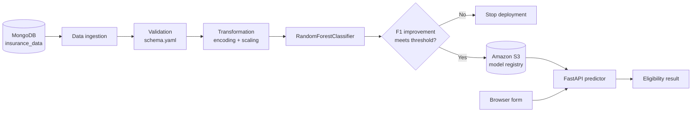
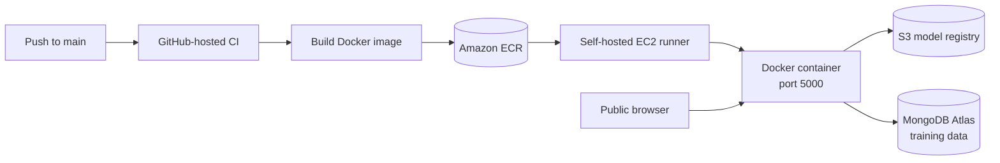

<div align="center">

# Insurely

### Vehicle insurance eligibility, turned into a clear next step.

An end-to-end machine learning application that ingests insurance data, validates and transforms features, evaluates a balanced classifier, publishes the accepted model to Amazon S3, and serves predictions through a focused FastAPI experience.

<br />


<br />

<a href="#-quick-start">Quick start</a>
&nbsp;&nbsp;•&nbsp;&nbsp;
<a href="#-how-it-works">How it works</a>
&nbsp;&nbsp;•&nbsp;&nbsp;
<a href="#-project-delivery-map">Build story</a>
&nbsp;&nbsp;•&nbsp;&nbsp;
<a href="#-model-and-data-contract">Configuration</a>
&nbsp;&nbsp;•&nbsp;&nbsp;
<a href="#-api-surface">API surface</a>

</div>

---

## ✦ What this project does

Insurely predicts whether a vehicle insurance customer is likely to be eligible based on:

- customer profile: gender, age, region, and vehicle vintage
- policy context: annual premium and sales channel
- insurance history: driving license and previous coverage
- vehicle signals: age band and reported damage

The project is intentionally built as a production-shaped MLOps workflow rather than a notebook-only experiment. Training artifacts are timestamped, the model is compared against the current S3 champion, and only an accepted model is pushed to the registry.

> **Important:** This is a machine learning estimate, not an underwriting decision or financial advice.

## ✨ Product experience

The frontend is a lightweight, responsive Jinja2 experience served directly by FastAPI:

- **Calm visual language** — mint surfaces, deep-green actions, generous spacing, and clear hierarchy.
- **Low-friction form design** — three logical steps with inline units and native validation.
- **Immediate feedback** — a clear “Eligible” or “Not Eligible” result appears in the same context as the form.
- **Responsive by default** — the grid collapses cleanly for tablet and mobile widths.
- **Accessible structure** — labels, required fields, status semantics, and descriptive page metadata are included.

## ⚡ Why this project stands out

This repository demonstrates the complete path from raw records to a user-facing, cloud-deployed ML product:

| What recruiters look for | What is implemented here |
| --- | --- |
| **Production thinking** | Layered components, typed artifacts, centralized configuration, structured logs, and explicit exception propagation |
| **Responsible model delivery** | Validation gates, held-out F1 evaluation, champion-versus-candidate comparison, and S3 promotion only after acceptance |
| **Real data engineering** | MongoDB Atlas ingestion, feature-store snapshots, schema contracts, deterministic feature alignment, and timestamped artifacts |
| **Practical ML** | Random Forest classification, class-imbalance treatment with SMOTEENN on training data only, and accuracy/F1/precision/recall tracking |
| **Product execution** | Responsive form UX, model-friendly input mapping, immediate result states, and a reusable predictor loaded once per app process |
| **Cloud delivery** | Docker, GitHub Actions, Amazon ECR, an EC2 self-hosted runner, and commit-SHA image tags |

## 🧱 Project delivery map

The following is the actual implementation journey, not a generic MLOps checklist. Each stage has a concrete output and a clear engineering purpose.

| Stage | What was done | Result / evidence |
| --- | --- | --- |
| **01 · Foundation** | Created the project skeleton, package discovery, dependency manifest, and modern `pyproject.toml`/`setup.py` packaging path. | The `src` package can be installed and imported consistently across local runs and containers. |
| **02 · Data source & exploration** | Connected MongoDB Atlas, loaded the insurance dataset through notebooks, and kept exploratory work in [`notebooks/`](notebooks/). | Training starts from a real document collection rather than a hard-coded local-only dataset. |
| **03 · Reliability layer** | Added centralized logging, custom exception wrapping, and persisted runtime logs. | Failures retain their root context and training/prediction behavior is observable through [`src/logger/`](src/logger/) and [`logs/`](logs/). |
| **04 · Data ingestion** | Built MongoDB-to-DataFrame access, removed configured identifiers, exported a feature-store CSV, and split data with a reproducible 75/25 ratio. | Every run creates train/test inputs under a timestamped artifact directory through [`src/components/data_ingestion.py`](src/components/data_ingestion.py). |
| **05 · Data validation** | Declared the dataset contract: target column, numerical fields, categorical fields, and drop columns. Generated a validation report before transformation can proceed. | Invalid or structurally incompatible data is stopped before it reaches the model; see [`config/schema.yaml`](config/schema.yaml). |
| **06 · Feature transformation** | Mapped gender values, one-hot encoded categorical features, aligned train/test columns, applied StandardScaler and MinMaxScaler, and persisted the preprocessing object. | Training and inference share the same feature logic through [`src/components/data_transformation.py`](src/components/data_transformation.py). |
| **07 · Imbalance-aware training data** | Applied SMOTEENN only to the training split, leaving the test split untouched to preserve a realistic evaluation distribution. | The model learns from a balanced training signal without contaminating held-out evaluation data. |
| **08 · Model training** | Configured a 500-tree `RandomForestClassifier`, calculated accuracy, F1, precision, and recall, and gated the candidate on the configured expected F1 score. | A trained model and its preprocessing object are packaged together by [`src/components/model_trainer.py`](src/components/model_trainer.py). |
| **09 · Evaluation & model promotion** | Loaded the current S3 model, recomputed its held-out F1, calculated candidate improvement, and required the configured change threshold before deployment. | Weak candidates are rejected; accepted candidates are pushed by the model pusher to the S3 registry. |
| **10 · Prediction product** | Built `VehicleData` to translate form flags into model-ready categorical values, initialized one reusable S3-backed predictor, and exposed browser/API routes. | A visitor can submit a form and receive an immediate eligibility result through [`app.py`](app.py). |
| **11 · Containerized delivery** | Created a Python 3.10 Docker image, added a GitHub Actions build-and-deploy workflow, published commit-tagged images to ECR, and ran them on an EC2 self-hosted runner. | A push to `main` can move the same application artifact from source control to a live container; see [`.github/workflows/aws.yaml`](.github/workflows/aws.yaml). |

## 🧭 How it works



### Training flow

1. **Ingest** the `insurance_data` collection from MongoDB.
2. **Persist and split** the feature store into train/test sets using a 75/25 split.
3. **Validate** the dataset against [`config/schema.yaml`](config/schema.yaml).
4. **Transform** categorical and numerical features and save the preprocessing object.
5. **Train** the configured `RandomForestClassifier`.
6. **Evaluate** the candidate against the current S3 model using F1 score.
7. **Promote** the candidate to S3 only when its improvement reaches the configured change threshold.

### Prediction flow

The API constructs a typed vehicle record from the form, derives the model’s categorical values from the UI flags, and reuses a single S3-backed predictor across requests. The model and preprocessor are loaded lazily and cached by the estimator.

## 🚀 Quick start

### Prerequisites

- Python 3.10 or newer
- MongoDB access to the `vehicle_insurance.insurance_data` collection for training
- An AWS S3 bucket containing the model, or permission to publish one
- AWS credentials with access to the configured model bucket

### 1. Clone and create an environment

```bash
git clone https://github.com/Asaduzzaman-Sheikh/Vehicle-insurance-prediction.git
cd Vehicle-insurance-prediction

python -m venv .venv
# Windows PowerShell
.venv\Scripts\Activate.ps1
# macOS/Linux
# source .venv/bin/activate
```

### 2. Install dependencies

```bash
python -m pip install --upgrade pip
pip install -r requirements.txt
```

### 3. Configure runtime secrets

Set these environment variables before starting the application:

| Variable | Used for |
| --- | --- |
| `CONNECTION_STRING` | MongoDB connection string used by training |
| `AWS_ACCESS_KEY_ID` | AWS S3 authentication |
| `AWS_SECRET_ACCESS_KEY` | AWS S3 authentication |

PowerShell:

```powershell
$env:CONNECTION_STRING = "mongodb+srv://<user>:<password>@<cluster>/<database>"
$env:AWS_ACCESS_KEY_ID = "<access-key>"
$env:AWS_SECRET_ACCESS_KEY = "<secret-key>"
```

Keep credentials out of source control. For deployed workloads, prefer the platform’s managed identity or secret store over long-lived access keys.

### 4. Start the application

```bash
python app.py
```

Open [http://localhost:5000](http://localhost:5000) to use the Insurely interface. FastAPI’s interactive documentation is available at [http://localhost:5000/docs](http://localhost:5000/docs).

### Docker

The repository includes a Python 3.10 image definition:

```bash
docker build -t insurely .
docker run --rm -p 5000:5000 \
  -e CONNECTION_STRING="mongodb+srv://<user>:<password>@<cluster>/<database>" \
  -e AWS_ACCESS_KEY_ID="<access-key>" \
  -e AWS_SECRET_ACCESS_KEY="<secret-key>" \
  insurely
```

## 🔁 Train or promote a model

With the required MongoDB and AWS variables configured, trigger the full pipeline from the running app:

```bash
curl http://localhost:5000/train
```

The pipeline writes timestamped artifacts under `artifacts/`, including:

```text
artifacts/<timestamp>/
├── data_ingestion/
│   ├── feature_store/data.csv
│   └── ingested/{train,test}.csv
├── data_validation/report.yaml
├── data_transformation/
│   ├── transformed/{train,test}.npy
│   └── transformed_object/preprocessing.pkl
└── model_trainer/trained_model/model.pkl
```

The current model registry is:

- **Bucket:** `vehicle-insurance-mlops-bucket`
- **Object:** `model.pkl`
- **Region:** `ap-southeast-2`

## ☁️ AWS deployment architecture

The project flow supports two complementary AWS paths:

1. **Model registry:** training evaluates a candidate model and pushes the accepted artifact to Amazon S3.
2. **Application delivery:** GitHub Actions builds the application image, publishes it to Amazon ECR, and runs that immutable image on an Ubuntu EC2 host.



### CI/CD workflow

The workflow is defined in [`.github/workflows/aws.yaml`](.github/workflows/aws.yaml):

- triggers on every push to `main`
- checks out the source and configures AWS credentials
- logs in to Amazon ECR
- builds an image tagged with the commit SHA
- pushes the immutable image tag to ECR
- waits for the build job to finish
- uses a **self-hosted** runner on EC2 to pull and start the image
- publishes the container on port `5000`

The deployment command injects MongoDB and AWS credentials into the running container. The application then loads its model from the configured S3 bucket when the predictor starts.

### Required GitHub Actions secrets

Create these repository secrets under **Settings → Secrets and variables → Actions**:

| Secret | Required by | Purpose |
| --- | --- | --- |
| `AWS_ACCESS_KEY_ID` | CI and CD | AWS authentication |
| `AWS_SECRET_ACCESS_KEY` | CI and CD | AWS authentication |
| `AWS_DEFAULT_REGION` | CI and CD | Region used by AWS actions and ECR |
| `ECR_REPOSITORY` | CI and CD | ECR repository name used by `aws.yaml` |
| `CONNECTION_STRING` | CD | MongoDB Atlas connection string |

> **Configuration detail:** the workflow reads `ECR_REPOSITORY`. If you are following an older project checklist that calls this secret `ECR_REPO`, use the name expected by [the workflow](.github/workflows/aws.yaml) or update both locations together.

Keep the S3 model bucket and the ECR repository in the AWS region selected by `AWS_DEFAULT_REGION`, and ensure the runtime IAM identity can read the model object. The application’s S3 client is currently configured for `ap-southeast-2`; update the application configuration if your deployment standardizes on another region.

### EC2 self-hosted runner

The deployment job requires a connected GitHub Actions self-hosted runner on the EC2 machine:

1. Launch an Ubuntu EC2 instance with Docker support and enough storage for image layers.
2. Install Docker and allow the `ubuntu` user to run it:

   ```bash
   sudo apt-get update -y
   curl -fsSL https://get.docker.com -o get-docker.sh
   sudo sh get-docker.sh
   sudo usermod -aG docker ubuntu
   newgrp docker
   ```

3. In the repository’s **Settings → Actions → Runners**, create a Linux self-hosted runner.
4. Run GitHub’s generated download and configuration commands on the EC2 instance.
5. Keep the runner available as a service rather than relying on an interactive `./run.sh` terminal.

The deployment job uses `runs-on: self-hosted`; without an online runner, CI can build and push the image but CD cannot start it.

### Open the deployed service

The container exposes port `5000` and the workflow maps it with `-p 5000:5000`. Allow inbound TCP `5000` in the EC2 security group, then visit:

```text
http://<ec2-public-ip>:5000
```

For production, restrict inbound access to trusted networks and place the service behind HTTPS and a reverse proxy instead of exposing the application port directly.

## 🧪 Model and data contract

The model is configured in [`config/model.yaml`](config/model.yaml):

```yaml
model_selection:
  model_name: RandomForestClassifier
  expected_score: 0.44
  params:
    n_estimators: 500
    class_weight: balanced
    random_state: 42
```

The feature contract lives in [`config/schema.yaml`](config/schema.yaml). The target is `Response`; identifiers are removed, categorical fields are encoded, and `Annual_Premium` is min-max scaled during transformation.

The web form exposes the model-ready signals as:

| UI section | Inputs |
| --- | --- |
| About you | Gender, Age, Region code, Vintage |
| Vehicle details | Annual premium, Policy sales channel, vehicle age flags |
| Insurance history | Driving license, previously insured, vehicle damage |

## 🔌 API surface

| Method | Route | Purpose |
| --- | --- | --- |
| `GET` | `/` | Render the prediction form |
| `POST` | `/` | Validate form data and return an eligibility result |
| `GET` | `/train` | Run ingestion → validation → transformation → training → evaluation → S3 push |
| `GET` | `/docs` | OpenAPI / Swagger UI |

The form endpoint expects `application/x-www-form-urlencoded` fields matching the names in [`templates/index.html`](templates/index.html). The API returns the rendered page with either `Eligible for Insurance` or `Not Eligible for Insurance`.

## 🗂️ Repository map

```text
.
├── app.py                    # FastAPI app and form endpoints
├── config/                   # Model and data contracts
├── .github/workflows/        # Build, publish, and EC2 deployment workflow
├── Dockerfile                # Python 3.10 application image
├── static/                   # Responsive product styling
├── templates/                # Jinja2 prediction interface
├── notebooks/                # Exploration and MongoDB examples
└── src/
    ├── components/           # Ingestion, validation, transformation, ML stages
    ├── configuration/        # MongoDB and AWS clients
    ├── entity/               # Config, artifact, and estimator contracts
    ├── pipeline/             # Training and prediction orchestration
    └── utils/                # Serialization and shared helpers
```

## 🛠️ Development notes

- Keep changes to model inputs synchronized across `schema.yaml`, `VehicleData`, and the HTML form.
- Treat `model.yaml` as the source of truth for model selection and hyperparameters.
- Inspect timestamped artifacts and [`logs/`](logs/) when diagnosing a failed training run.
- Do not commit credentials, downloaded models, or generated artifact directories.
- For a new model, preserve the estimator contract used by `S3Estimator` so the prediction path remains stable.

## 📄 License and ownership

This project is maintained by [Asaduzzaman Sheikh](https://github.com/Asaduzzaman-Sheikh). Add a repository license before distributing the project beyond its intended development context.

---

<div align="center">

**Built to make an ML prediction feel understandable.**

</div>
